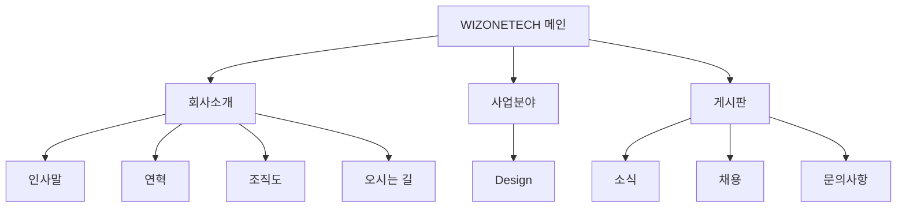

> **메인 영상 업데이트:** 사용자가 제공한 `top_video.mp4`를 `assets/media/top_video.mp4`로 복사해 적용했습니다. 1280×720, 10초, 약 7.7MB. 전체 화면 자동 무음 반복·투명 헤더·스크롤 안내·일시정지/재개·전체 화면 보기를 제공합니다. 화면 밖 및 백그라운드에서는 일시정지하며 동작 줄이기 설정을 반영합니다. 이전 메인의 고정 스크롤 도식 연출은 제거했고, 독립된 연혁 스크롤은 유지했습니다. Chrome 실제 재생·정지/재개와 모바일 가로 넘침을 점검했습니다. 아래 메인 사진 설명은 이전 이력입니다.

> **지도 업데이트:** 오시는 길에 API 키 없이 표시하는 구글 지도 iframe을 적용했습니다. 주소는 경기 용인시 기흥구 서천로201번길 11이며 층수는 주소 안내에 표시합니다. 네이버 지도 버튼은 외부 길찾기용으로 유지했습니다. 네이버 API 키 설정과 지도 스크립트는 제거했습니다.

> **오시는 길 업데이트:** 사용자 확인 주소인 경기 용인시 기흥구 서천로201번길 11, 10층을 적용했습니다. 오시는 길 메뉴와 섹션에서 네이버 지도 주소 검색으로 연결합니다. 이전 호수 표기는 제거했습니다. API 키 없이 동작하는 외부 지도 링크 방식입니다.

> **현재 버전:** 이전 Design 레이아웃과 스크롤 전환에 실제 프리즘 사진을 적용했습니다. 사용 파일: `assets/media/prism.jpg` (2400px 파생본). 제작자 Design Bits, [원본](https://www.pexels.com/photo/optical-glass-triangular-prism-3845161/), [Pexels License](https://www.pexels.com/legal-pages/license/). 무료 상업적 웹 사용·출처 표기 의무 없음·수정 허용을 확인했습니다(2026-11-05). 식별 가능한 로고·인물 없음. 생성 이미지는 사용하지 않았으며 CSS로 밝기·채도·구도만 조정했습니다. 아래 반도체 이미지와 영상 구현 기록은 과거 이력입니다.

# WIZONETECH — Website Re-Design

기존 [위즈원텍 웹사이트](https://wizonetech.co.kr/)를 **리디자인**하는 정적 웹 퍼블리싱 프로젝트입니다. 국내외 잠재 고객에게 반도체 설계 전문성을 전달하고 사업 문의로 연결하는 것이 목적입니다.

## 현재 시안

- 현재 팀 구성에 맞춰 **Design만 소개합니다. Verification은 서비스·메타데이터·메뉴·문의 링크에서 제거했습니다.** 이전 웹사이트의 검증 자료는 현재 역량의 근거로 사용하지 않습니다.
- 첫 화면 → RTL·블록 통합 → 합성·타이밍·전력 의도 → Design 상세 → 회사소개·소식·문의.
- 짙은 실제 회로 영상과 밝은 본문을 대비시키고, GSAP로 영상 프레임·기술 도식·텍스트를 연결합니다.
- 데스크톱은 약 2.8 화면의 스크롤 동안 소개 → 설계 구현 → 설계 정교화 장면으로 전환합니다. 역방향 스크롤도 지원합니다.
- 800px 이하에서는 고정 구간을 해제하고 포스터 및 세로 콘텐츠를 사용합니다. 사용자가 원하면 영상을 재생할 수 있습니다.
- `prefers-reduced-motion`에서는 자동 영상과 스크롤 모션을 중지합니다. JavaScript·GSAP가 없어도 본문과 메뉴를 읽을 수 있습니다.
- 영상 일시정지/재생 버튼, 화면 밖·백그라운드 재생 정지, 실패 시 포스터 대체를 제공합니다.
- 메인 모션 시안까지 구현했습니다. 영어·하위 페이지 확장 및 운영 도메인 전환은 후속 범위입니다.

## 실행과 배포

```sh
python3 -m http.server 4173 --bind 127.0.0.1
```

<http://localhost:4173>에서 확인합니다. `index.html`을 직접 열어도 동작합니다.

배포 대상은 `index.html`, `styles.css`, `script.js`, `assets/`입니다. 빌드 명령·환경 변수·백엔드는 없습니다. 저장소 전체가 아닌 배포 파일만 정적 호스팅에 업로드합니다. MP4는 `video/mp4`로 제공하고 HTTP Range 요청을 지원하는 호스팅을 권장합니다.

- HTML·CSS·JavaScript + 로컬 GSAP **3.15.1** / ScrollTrigger **3.15.1**.
- 프레임워크, Three.js, 관리자, 로그인, 데이터베이스 없음.
- 문의는 이메일·전화 링크입니다. 문의 내용을 서버에 접수하거나 저장하지 않습니다.
- 로컬 MP4 약 4 MB, 포스터 약 70 KB. 모바일에서는 재생 요청 전 MP4를 내려받지 않습니다.
- 라이브러리 원본의 저작권 헤더를 유지했고 `assets/vendor/GSAP-LICENSE.txt`에 사용 조건을 보관했습니다.

## 미디어와 라이선스

이미지·영상을 AI로 생성하지 않았습니다. 이전의 생성형 칩 일러스트는 제거했습니다. 기술 도식은 코드로 작성한 개념적 선·블록·파형이며 실제 제품이나 측정 데이터가 아닙니다.

| 항목 | 기록 |
| --- | --- |
| 사용 자료 | A Close-Up Video of a Circuit Board Components |
| 제작자 | Video Kickstarter |
| 원본 페이지 | https://www.pexels.com/video/a-close-up-video-of-a-circuit-board-components-2376982/ |
| 원본 게시일 | 2019-05-27 |
| 영상 URL | https://videos.pexels.com/video-files/2376982/2376982-hd_1920_1080_24fps.mp4 |
| 포스터 URL | https://images.pexels.com/videos/2376982/free-video-2376982.jpg?auto=compress&w=1600 |
| 로컬 파일 | `assets/media/circuit-macro.mp4`, `assets/media/circuit-poster.jpg` |
| 사용 조건 | Pexels License — 무료 상업적 웹사이트 사용 및 수정 허용, 출처 표기 의무 없음 |
| 공식 라이선스 | https://www.pexels.com/legal-pages/license/ |
| 이용약관 | https://www.pexels.com/terms-of-service/ |
| 확인일 | 2026-11-05 |
| 시각 점검 | 11초 원본의 0.1 / 2.1 / 4.1 / 6.1 / 8.1 / 10.1초 프레임 확인. 식별 가능한 인물·브랜드 로고·시설명은 발견하지 못함 |
| 적용 방식 | 원본을 로컬 제공하며 CSS로 어둡기·채도·프레이밍 조정. 산업 이미지로 표기. 실제 위즈원텍 제품·시설로 주장하지 않음 |

Pexels는 브랜드의 보증·제휴를 암시하는 사용, 변경 없는 복제물 판매, 스톡 플랫폼 재배포, 상표로 사용하는 행위 등을 제한합니다. 이 자료는 완성된 기업 웹사이트의 시각 요소로 사용하며 스톡 자료로 재판매하지 않습니다. 원본 페이지의 무료 라이선스와 시각적 표기를 확인한 것이며, 제3자 권리의 절대적 부재를 보증하는 것은 아닙니다.

검토 후 제외한 후보: Tima Miroshnichenko의 [6754818](https://www.pexels.com/video/close-up-view-of-a-motherboard-6754818/) — 제조사 표기가 식별되어 배포 자산에 포함하지 않았습니다. 유료 자료는 구매하지 않았습니다.

GSAP: https://gsap.com/community/standard-license/ — 웹사이트에서의 무료 상업 사용 허용. 버전 고정 원본은 https://registry.npmjs.org/gsap/-/gsap-3.15.1.tgz 에서 확보했습니다.

## 사업 콘텐츠와 남은 확인 항목

- [기존 Design 페이지](https://wizonetech.co.kr/Design)의 이미지 자료를 확인해 RTL, 블록 통합, IP-XACT 패키징, SDC, Synthesis·STA, UPF, Power-aware Synthesis를 재구성했습니다. 이 항목들의 **현재 팀 제공 범위는 운영 게시 전 회사 확인이 필요합니다.**
- 전화·이메일은 기존 공식 사이트 기준입니다. 메인 페이지는 용인시, 사업 하위 페이지는 수원시 주소를 사용하고 있어 시안에는 메인의 용인시 주소를 반영했습니다. 운영 배포 전 현재 주소를 확인해야 합니다.
- 가상의 고객사·시장 순위·인증·성과 수치·측정값은 사용하지 않았습니다.
- 소식은 자료 미제공 상태입니다. 채용 문의 링크는 채용 진행 여부를 의미하지 않습니다.
- 기존 로고는 `assets/wizonetech-logo.png`로 보존했습니다.

## 레퍼런스

- [GSAP UI Interactions Showcase](https://gsap.com/showcase/?tags=UI+Interactions): 스크롤에 연결된 화면 구성과 장면 전환의 방향.
- [ADTechnology](https://www.adtek.co.kr/index.php?lang=on): 기술 솔루션과 고객 문의를 잇는 정보 구조.
- [GAONCHIPS](https://gaonchips.com/), [Telechips](https://www.telechips.com/): 국내 디자인하우스·팹리스 비교 대상.

경쟁사 이미지·문구·실적은 복제하지 않았습니다.

## 전체 사이트 확장 구조



## 검증 결과

2026-11-05, 로컬 Chrome 및 DevTools 에뮬레이션 기준:

- `node --check script.js`, `git diff --check` 통과.
- 화면 콘텐츠·메타데이터에서 Verification·검증·Coverage·Dynamic CDC·Test Plan 소개가 남아 있지 않음을 확인.
- 1440 / 1024 / 768 / 390 / 320px에서 레이아웃 점검. 화면 크기 변경 시 ScrollTrigger 재계산 후 가로 넘침 없음.
- 소개 → 설계 → 타이밍 장면의 정방향·역방향 전환 및 비활성 장면의 포커스 제외 확인.
- 실제 MP4 재생·일시정지·다시 재생, 화면 밖 자동 정지 확인.
- 모바일 메뉴 열기·Escape 닫기·메뉴 버튼으로 포커스 복귀 확인. 내부 앵커 대상 누락 0건.
- 동작 줄이기 설정에서 고정 구간 0개, 영상 자동 재생 중지, 전체 본문 표시 확인.
- 모든 스크립트를 제외한 문서에서 모바일 메뉴·본문·포스터 표시 확인.
- GSAP가 없는 새 문서에서 앱 메뉴 기능 및 정적 본문 유지 확인.
- 영상 URL 실패 시 포스터 유지·재생 버튼 숨김 확인.
- 정상 페이지 Chrome 콘솔 오류 없음. 실패 테스트 탭에서 유도한 영상 404는 정상 페이지 오류와 구분함.

실기기 Safari/Firefox와 운영 호스팅에서의 확인은 아직 수행하지 않았습니다.

## 후속 메인 모션 상태

Wafer → Physical Design → Logical Synthesis 스크롤 확대 요청은 자료 확보 단계입니다. 무료 상업 사용·출처 표기 의무 없음 조건으로 후보를 조사했으나, 내부 확대에 적합한 고해상도 Physical Design 자료가 확보되지 않아 승인된 계획에 따라 교체를 보류했습니다. 현재 화면은 위의 기존 Design 시안입니다. 상세 후보와 제외 사유는 [메인 모션 자료 검토](docs/main-motion-assets.md)를 참고하세요.
